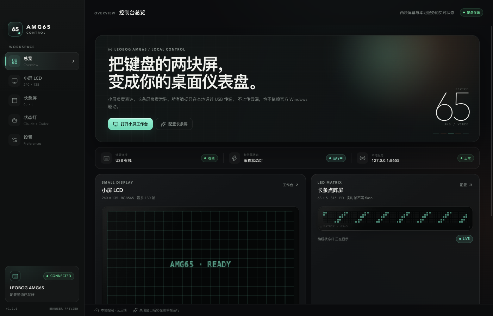
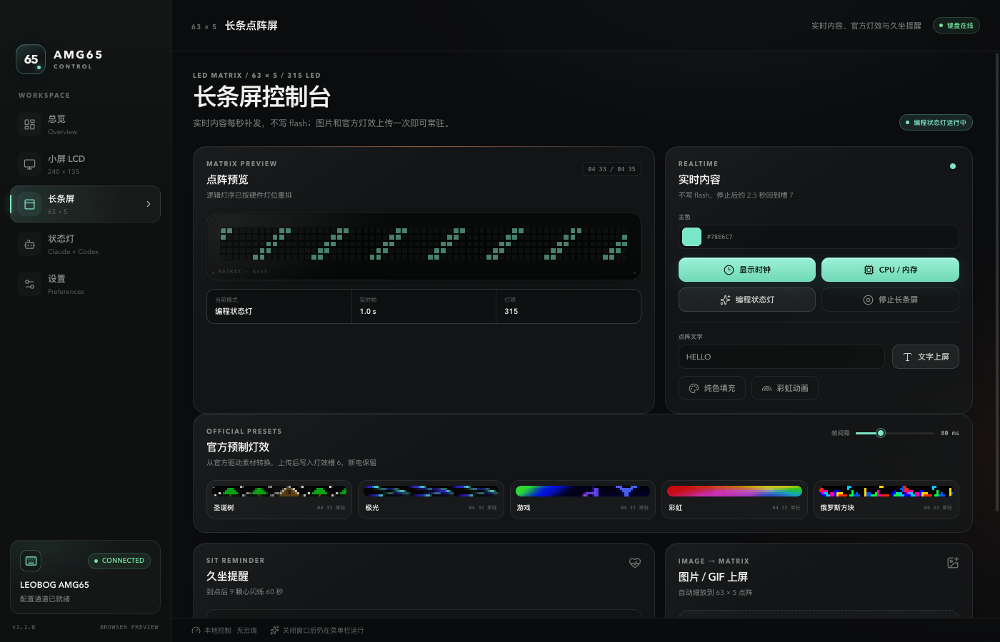

# AMG65 Control

> Unofficial macOS control console for the **LEOBOG AMG65** mechanical keyboard.
> Control both displays locally over USB, without the Windows driver.

[](#requirements)
[](#web-panel)
[](#desktop-app)
[](LICENSE)



The official LEOBOG software is Windows-only. This project reconstructs the
USB protocol used by driver 1.0.3.3 and exposes it through two interfaces:

- A dependency-light **web panel** for quick local control.
- A native-feeling **Electron app** with a menu-bar icon, login item, and
  packaged Python backend.

Both interfaces drive the same Python protocol library. No keyboard data is
sent to a remote service.

## Features

- **240 x 135 LCD:** image, GIF, text, solid color, brightness, and time sync.
- **63 x 5 LED matrix:** clock, CPU/memory bars, text, color, rainbow, and
  live image/GIF previews.
- **Persistent LED effects:** upload animations to the firmware's slot 6.
- **Programming status light:** Claude Code and Codex states shown side by
  side on the matrix.
- **Sit reminder:** configurable interval with an animated heart sequence.
- **Menu-bar app:** hide instead of quit, launch at login, quick status-light
  actions, and backend logs.



## Requirements

- macOS 13 or newer (Apple Silicon build is configured by default).
- LEOBOG AMG65 connected by **USB cable**. Bluetooth does not expose the
  configuration interfaces.
- Python 3.10+.
- Node.js 20+ only if you want to build the desktop UI.

## Quick Start

```bash
git clone https://github.com/quqingchen9-hub/amg65-control.git
cd amg65-control

python3 -m venv .venv
source .venv/bin/activate
pip install -r requirements.txt

python3 panel/server.py
open http://127.0.0.1:8655
```

The service binds to `127.0.0.1` only. Keep the keyboard wired and do not run
the official Windows driver at the same time.

### Web panel

The web panel is a single-page interface served by Python's standard HTTP
server. It uses no frontend build step.

```text
panel/
├── index.html              UI
├── server.py               local HTTP API
└── static/keyboard.png     key layout
```

### Desktop app

```bash
cd desktop
npm install
npm run dev
```

The development app starts the Python backend from `panel/server.py`. To
produce a distributable macOS build:

```bash
npm run build:backend   # PyInstaller backend
npm run build:app       # .app in desktop/dist
npm run dist            # .dmg in desktop/dist
```

The checked-in build is unsigned and not notarized. On first launch, use
Finder's **Open** context menu or allow it under **System Settings > Privacy
& Security**. See [desktop/README.md](desktop/README.md) for the app layout
and menu-bar behavior.

## Protocol

The full reverse-engineered protocol is documented in
[docs/protocol.md](docs/protocol.md). Key facts:

| Display | Resolution | Transport | Persistence |
|---|---|---|---|
| Small LCD | 240 x 135 RGB565 | `04 72` upload | survives disconnect |
| LED matrix | 63 x 5, 315 LEDs | `04 33` animation | slot 6, survives power loss |
| LED matrix | 63 x 5, 315 LEDs | `04 35` live frame | ~2.5 s, resend every second |

The device identifies as `0x0C45:0x800A`. Configuration commands use USB
interface 2; bulk data uses interface 3 through libusb.

### Command-line examples

```bash
cd tool
python3 amg65_cli.py ping
python3 amg65_cli.py color FF8800
python3 amg65_cli.py text "HELLO"
python3 amg65_cli.py gif ~/Pictures/demo.gif --fps 15
```

Stop the web panel or desktop backend before running direct CLI commands so
they do not compete for the USB interfaces.

## Preset Effects

The five built-in preset animations are derived from the official driver's
SQLite asset `ledlayer_v2.data`. Vendor binaries and extracted assets are
intentionally excluded from this repository.

To enable them locally:

```bash
mkdir -p vendor/db
cp /path/to/extracted/app/db/ledlayer_v2.data vendor/db/
```

Or point to a copy anywhere:

```bash
export AMG65_PRESET_DB="$HOME/AMG65-assets/ledlayer_v2.data"
```

Without this file, the rest of the application remains functional and the
preset endpoint returns a clear unavailable response.

## Project Layout

```text
amg65-control/
├── panel/                  web panel and local HTTP API
├── tool/                   USB protocol, matrix renderer, presets, CLI
├── desktop/                React + Electron app
├── docs/protocol.md        reverse-engineered USB protocol
├── re_scripts/             optional static-analysis helpers
├── requirements.txt        runtime dependencies
└── requirements-re.txt     analysis-only dependencies
```

## Troubleshooting

| Symptom | Check |
|---|---|
| `未找到 AMG65 配置接口` | Use the USB cable, not Bluetooth; close LEOBOG's Windows driver. |
| Port already in use | Stop the old backend or run `python3 panel/server.py 8656`. |
| Live matrix turns off | Normal after ~2.5 s; keep the client running so it resends every second. |
| Presets unavailable | Set `AMG65_PRESET_DB` to the vendor `ledlayer_v2.data`. |
| Desktop app blocked by Gatekeeper | Right-click the app, choose **Open**, then confirm. |
| App opens but device is offline | Check `~/Library/Application Support/AMG65 Control/backend.log`. |

## Limitations

- This is an unofficial community project, not affiliated with LEOBOG.
- The protocol was inferred from one driver and firmware version; other
  revisions may differ.
- The desktop build targets Apple Silicon. Intel and notarized builds are not
  currently configured.
- Vendor binaries, firmware, fonts, and extracted artwork are not distributed.

## Contributing

Issues and pull requests are welcome. Please include the keyboard model,
firmware version, macOS version, and relevant backend log lines when reporting
device behavior. Do not commit vendor binaries, extracted driver databases,
or firmware images.

## License

Original source code in this repository is released under the [MIT License](LICENSE).
LEOBOG, AMG65, and associated marks belong to their respective owners.

